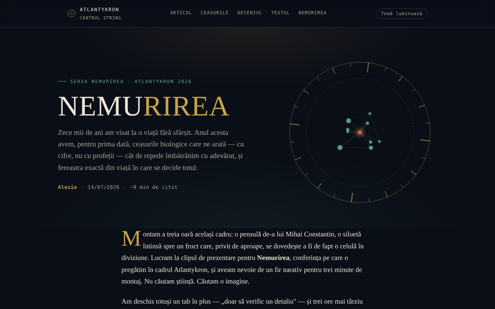

# NEMURIREA — Das Alter, das unser biologisches Schicksal schreibt

[English](README.md) · [Română](README.ro.md) · [Français](README.fr.md) · [Italiano](README.it.md) · [Español](README.es.md) · [Português](README.pt.md) · **Deutsch** · [Magyar](README.hu.md)

**Version:** 1.2.0 · **Zuletzt aktualisiert:** 2026-10-19

Oberflächensprachen: **Română, English, Français, Italiano, Español, Português (PT), Deutsch, Magyar**

Interaktiver Essay über biologische Uhren und die Wissenschaft der Langlebigkeit, in der Reihe Nemurirea, Atlantykron 2026.

**Online-App:** https://chiuta.github.io/Nemurirea/

## Was es ist

NEMURIREA ist eine Essay-Seite in einer einzigen HTML-Datei, von Alexio gezeichnet, datiert auf den 14.07.2026 (etwa 9 Minuten Lesezeit). Ausgangspunkt sind das Interview, das Elena Oceanu mit Prof. Dr. Alberto Beretta geführt hat und das auf SmartLiving.ro erschienen ist, sowie die auf dem Milan Longevity Summit 2026 vorgestellten Daten; der Text erklärt, dass die wissenschaftlichen Ideen Beretta und den zitierten Forschenden gehören, während Interpretation und Struktur dem Autor des Essays gehören. Der Essay dient der Information und Bildung und stellt keine medizinische Beratung dar (Hinweis aus der App).

## Funktionen

- Essay in Abschnitten: „Der alte Traum von zehntausend Jahren“ (Zeitleiste von Gilgamesch bis zur Kryonik), „Die wahren Uhren“ (epigenetische Uhr, GlycanAge, Proteom-Uhren), „Drei Entdeckungen vom Milan Longevity Summit 2026“, „Das entscheidende Jahrzehnt“, „Wie man Wissenschaft von Marketing unterscheidet“, „Teste deinen wissenschaftlichen Instinkt“, „Die wahre Unsterblichkeit“, „Quellen und Lektüre“.
- Navigation in der Kopfzeile: Artikel, Die Uhren, Das Jahrzehnt, Der Test, Die Unsterblichkeit.
- Test des wissenschaftlichen Instinkts: fünf zufällig aus zehn gezogene Fragen (Multiple Choice, Antwortreihenfolge gemischt), mit einem erklärenden Hinweis nach jeder Antwort („Nächste Frage“, „Test wiederholen“); am Ende Verweise auf die Essay-Abschnitte, die den falschen Antworten entsprechen.
- Dünne Lesefortschrittsleiste oben (beim Drucken ausgeblendet).
- „↑“-Schaltfläche zum Zurückspringen an den Seitenanfang; Elemente erscheinen beim Scrollen nach und nach.
- Schaltfläche „Helles Thema / Nacht-Thema“ in der Kopfzeile (das Nacht-Thema bleibt Standard; die Wahl wird in `localStorage` gespeichert, falls der Browser es erlaubt).
- Vorschaubild für soziale Netzwerke (`nemurirea-og.png`) zum Teilen.

## Bedienungsanleitung

1. Lies den Essay durch Scrollen oder nutze die Links in der Kopfzeile (Artikel, Die Uhren, Das Jahrzehnt, Der Test, Die Unsterblichkeit).
2. Wähle im Abschnitt „Teste deinen wissenschaftlichen Instinkt“ für jede Frage eine Antwort; der erklärende Hinweis erscheint.
3. Drücke „Nächste Frage“, um fortzufahren; am Ende drückst du „Test wiederholen“, um neu zu beginnen.
4. Der Abschnitt „Quellen und Lektüre“ enthält die Links zu den zitierten Quellen (SmartLiving.ro, Milan Longevity Summit, SoLongevity, Nobel Prize, arXiv, GlycanAge).
5. Die „↑“-Schaltfläche bringt dich zurück nach oben.

## Datenschutz und Netzwerk

- Lokal: Der einzige in `localStorage` gespeicherte Wert ist die Themenwahl (Schlüssel `nemurirea.tema`); `sessionStorage` und IndexedDB werden nicht verwendet, und das Testergebnis wird nicht gespeichert.
- Netzwerk: Ich habe keine `fetch`-Aufrufe und keine externen Skripte oder Schriften gefunden; die Seite lädt aus einer einzigen Datei (plus dem Bild `nemurirea-og.png`, das nur als Vorschau für soziale Netzwerke dient).
- Die externen Links (smartliving.ro, milanlongevitysummit.org, solongevity.com, nobelprize.org, arxiv.org, glycanage.com, centrulstring.ro) öffnen sich nur per Klick. Die Fußzeile erklärt: „Einzelne Datei, offline, ohne Telemetrie“.

## Lokale Ausführung / offline

Lade `index.html` herunter und öffne sie in einem Browser; Essay und Test funktionieren ohne Internet. Die Links unter „Quellen und Lektüre“ benötigen Internet.

## Verlauf / Changelog

### 1.1.0 — 2026-10-14
- Datensicherung und Datenkennzeichnung (fff-kit).

### 1.0.0 — 12. Oktober 2026
- Version und Datum der letzten Aktualisierung werden in der App angezeigt (Fußzeile).

### 11.10.2026 (dritte Aktualisierung) — 11. Oktober 2026
- Optionales helles Thema (Schaltfläche in der Kopfzeile; Kontrast mit axe in beiden Themen geprüft, auf Desktop und Mobilgerät); das Nacht-Thema bleibt Standard.
- CSP: `connect-src 'none'`.

### 11.10.2026 (zweite Aktualisierung) — 11. Oktober 2026
- Test: Der Fragenpool wurde von 5 auf 10 Fragen erweitert (alle auf dem Text des Essays beruhend); jede Runde zieht 5 zufällig, sodass eine Wiederholung nicht mehr immer dieselben Fragen bringt; das Ergebnis nennt die Abschnitte zum Nachlesen.
- Lesefortschrittsleiste.

### 11.10.2026 — 11. Oktober 2026
- Der Test: Die Reihenfolge der Antwortoptionen wird bei jeder Frage und jeder Wiederholung gemischt (die richtige Antwort ist nicht mehr fast immer die zweite Option).
- Eine strikte Content-Security-Policy wurde hinzugefügt (Skript mit Hash, keine Netzwerkverbindungen); axe-Prüfung ohne Verstöße.

## Lizenz

MIT — siehe Datei `LICENSE`. Die Fußzeile der App nennt: „© 2026 Centrul STRING · Text und Montage: Alexio“.

## Autor

Alexio — Alexandru-Ionuț Chiuță, Kontakt: alexio@trom.tf. Die App nennt das Centrul STRING (CSPCF) als Herausgeber der Reihe Nemurirea im Rahmen von Atlantykron 2026.

## Englische Zusammenfassung

NEMURIREA ist ein rumänischsprachiger Essay in einer einzigen Datei über biologische Alterungsuhren und die Wissenschaft der Langlebigkeit (Teil der Reihe Nemurirea, Atlantykron 2026) mit einem kurzen Multiple-Choice-Quiz. Grundlage sind ein Interview mit Prof. Alberto Beretta und Daten des Milan Longevity Summit 2026. Es wurden weder Browser-Speicher noch externe Anfragen gefunden; informativ, keine medizinische Beratung.
