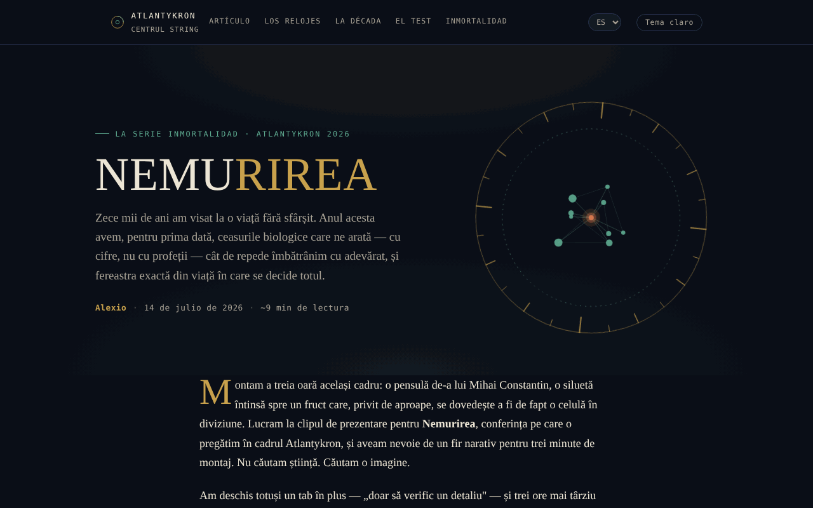

# NEMURIREA — La edad que escribe nuestro destino biológico

[English](README.md) · [Română](README.ro.md) · [Français](README.fr.md) · [Italiano](README.it.md) · **Español** · [Português](README.pt.md) · [Deutsch](README.de.md) · [Magyar](README.hu.md)

**Versión:** 2.0.0 · **Última actualización:** 2026-10-26

Idiomas de la interfaz: **Română, English, Français, Italiano, Español, Português (PT), Deutsch, Magyar**

Ensayo interactivo sobre los relojes biológicos y la ciencia de la longevidad, dentro de la serie Nemurirea, Atlantykron 2026.

**Aplicación en línea:** https://chiuta.github.io/Nemurirea/

## Qué es

NEMURIREA es una página-ensayo en un solo archivo HTML, firmada por Alexio, fechada el 14/07/2026 (unos 9 minutos de lectura). Parte de la entrevista realizada por Elena Oceanu al prof. dr. Alberto Beretta, publicada en SmartLiving.ro, y de los datos presentados en el Milan Longevity Summit 2026; el texto declara que las ideas científicas pertenecen a Beretta y a los investigadores citados, mientras que la interpretación y la estructura pertenecen al autor del ensayo. El ensayo tiene carácter informativo y educativo y no constituye consejo médico (precisión incluida en la aplicación).

## Funciones

- Ensayo en secciones: «El viejo sueño de diez mil años» (cronología de Gilgamesh a la criogenia), «Los relojes de verdad» (reloj epigenético, GlycanAge, relojes proteómicos), «Tres descubrimientos del Milan Longevity Summit 2026», «La década decisiva», «Cómo distinguir la ciencia del marketing», «Pon a prueba tu instinto científico», «La verdadera inmortalidad», «Fuentes y lecturas».
- Navegación en la cabecera: Artículo, Los relojes, La década, La prueba, La inmortalidad.
- Prueba de instinto científico: cinco preguntas elegidas al azar entre diez (opción múltiple, orden de las respuestas mezclado), con una nota explicativa tras cada respuesta («Siguiente pregunta», «Repetir la prueba»); al final, remisiones a las secciones del ensayo correspondientes a las respuestas erróneas.
- Fina barra de progreso de lectura en la parte superior (oculta al imprimir).
- Botón «↑» para volver al principio de la página; los elementos aparecen progresivamente al desplazarse.
- Botón «Tema claro / Tema nocturno» en la cabecera (el tema nocturno sigue siendo el predeterminado; la elección se conserva en `localStorage`, si el navegador lo permite).
- Imagen de vista previa social (`nemurirea-og.png`) para compartir.

## Guía de uso

1. Lee el ensayo desplazando la página o usa los enlaces de la cabecera (Artículo, Los relojes, La década, La prueba, La inmortalidad).
2. En la sección «Pon a prueba tu instinto científico» elige una respuesta para cada pregunta; aparece la nota explicativa.
3. Pulsa «Siguiente pregunta» para continuar; al final pulsa «Repetir la prueba» para empezar de nuevo.
4. La sección «Fuentes y lecturas» contiene los enlaces a las fuentes citadas (SmartLiving.ro, Milan Longevity Summit, SoLongevity, Nobel Prize, arXiv, GlycanAge).
5. El botón «↑» te devuelve arriba.

## Privacidad y red

- Local: el único valor guardado en `localStorage` es la elección del tema (clave `nemurirea.tema`); no se usan `sessionStorage` ni IndexedDB, y el resultado de la prueba no se guarda.
- Red: no encontré llamadas `fetch` ni scripts o fuentes externos; la página se carga desde un único archivo (más la imagen `nemurirea-og.png`, usada solo como vista previa social).
- Los enlaces externos (smartliving.ro, milanlongevitysummit.org, solongevity.com, nobelprize.org, arxiv.org, glycanage.com, centrulstring.ro) solo se abren si haces clic en ellos. El pie de página declara «Archivo único, offline, sin telemetría».

## Ejecución local / offline

Descarga `index.html` y ábrelo en un navegador; el ensayo y la prueba funcionan sin internet. Los enlaces de «Fuentes y lecturas» requieren internet.

## Historial / Changelog

### 1.2.4 — 2026-10-22

fff-kit 1.1.4: áreas táctiles y texto mínimo. Áreas táctiles/texto corregidos en la aplicación.

### 1.2.3 — 2026-10-22

fff-kit 1.1.2: PBKDF2 con 600.000 iteraciones, protección anti-clickjacking.

### 1.2.2 — 2026-10-22
- Móvil: el texto mide al menos 12 px y los botones y campos tienen áreas táctiles mayores en pantallas estrechas.
- Móvil: corregido el desbordamiento horizontal de 2 px de la cabecera (el botón de tema ya no sobresale en pantallas de 360 px); los enlaces de las listas de referencias tienen áreas táctiles mayores.

### 1.1.0 — 2026-10-14
- Copia de seguridad y etiquetado de datos (fff-kit).

### 1.0.0 — 12 de octubre de 2026
- La versión y la fecha de la última actualización se muestran en la aplicación (pie de página).

### 11.10.2026 (tercera actualización) — 11 de octubre de 2026
- Tema claro opcional (botón en la cabecera; contraste comprobado con axe en ambos temas, en escritorio y móvil); el tema nocturno sigue siendo el predeterminado.
- CSP: `connect-src 'none'`.

### 11.10.2026 (segunda actualización) — 11 de octubre de 2026
- Prueba: el conjunto se amplió de 5 a 10 preguntas (todas basadas en el texto del ensayo); cada ronda toma 5 al azar, de modo que repetir la prueba ya no repite siempre las mismas preguntas; el resultado indica las secciones que conviene releer.
- Barra de progreso de lectura.

### 11.10.2026 — 11 de octubre de 2026
- La prueba: el orden de las opciones de respuesta se mezcla en cada pregunta y en cada repetición (la respuesta correcta ya no es casi siempre la segunda opción).
- Añadida una Content-Security-Policy estricta (script con hash, sin conexiones de red); comprobación con axe sin infracciones.

## Licencia

MIT — véase el archivo `LICENSE`. El pie de página de la aplicación indica: «© 2026 Centrul STRING · Texto y montaje: Alexio».

## Autor

Alexio — Alexandru-Ionuț Chiuță, contacto: alexio@trom.tf. La aplicación menciona al Centrul STRING (CSPCF) como editor de la serie Nemurirea en el marco de Atlantykron 2026.

## Resumen

NEMURIREA es un ensayo en rumano, en un solo archivo, sobre los relojes biológicos del envejecimiento y la ciencia de la longevidad (serie Nemurirea, Atlantykron 2026), con un breve cuestionario de opción múltiple. Se basa en una entrevista con el prof. Alberto Beretta y en datos del Milan Longevity Summit 2026. No se encontró almacenamiento en el navegador ni peticiones externas; es informativo, no consejo médico.
