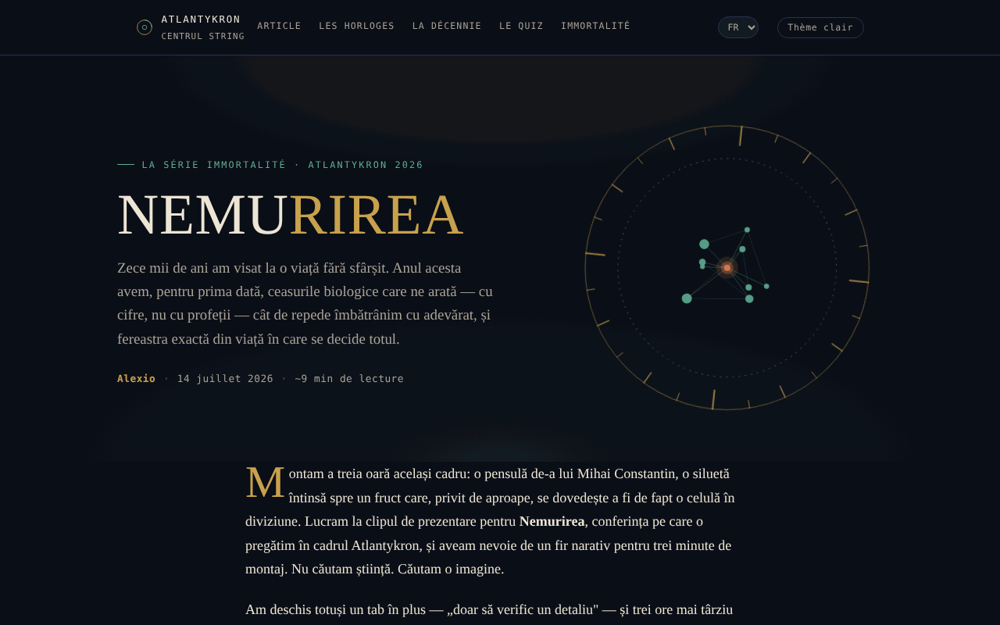

# NEMURIREA — L'âge qui écrit notre destin biologique

[English](README.md) · [Română](README.ro.md) · **Français** · [Italiano](README.it.md) · [Español](README.es.md) · [Português](README.pt.md) · [Deutsch](README.de.md) · [Magyar](README.hu.md)

**Version :** 1.2.2 · **Dernière mise à jour :** 2026-10-22

Langues de l'interface : **Română, English, Français, Italiano, Español, Português (PT), Deutsch, Magyar**

Essai interactif sur les horloges biologiques et la science de la longévité, dans la série Nemurirea, Atlantykron 2026.

**Application en ligne :** https://chiuta.github.io/Nemurirea/

## Présentation

NEMURIREA est une page-essai dans un seul fichier HTML, signée Alexio, datée du 14/07/2026 (environ 9 minutes de lecture). Elle part de l'entretien réalisé par Elena Oceanu avec le prof. dr Alberto Beretta, publié sur SmartLiving.ro, et des données présentées au Milan Longevity Summit 2026 ; le texte déclare que les idées scientifiques appartiennent à Beretta et aux chercheurs cités, tandis que l'interprétation et la structure appartiennent à l'auteur de l'essai. L'essai a une visée informative et éducative et ne constitue pas un avis médical (précision figurant dans l'application).

## Fonctionnalités

- Essai en sections : « Le vieux rêve de dix mille ans » (chronologie de Gilgamesh à la cryogénie), « Les vraies horloges » (horloge épigénétique, GlycanAge, horloges protéomiques), « Trois découvertes du Milan Longevity Summit 2026 », « La décennie décisive », « Comment distinguer la science du marketing », « Testez votre instinct scientifique », « La véritable immortalité », « Sources et lectures ».
- Navigation dans l'en-tête : Article, Les horloges, La décennie, Le test, L'immortalité.
- Test d'instinct scientifique : cinq questions tirées au hasard parmi dix (choix multiples, ordre des réponses mélangé), avec une note explicative après chaque réponse (« Question suivante », « Refaire le test ») ; à la fin, renvois vers les sections de l'essai correspondant aux mauvaises réponses.
- Fine barre de progression de lecture en haut de page (masquée à l'impression).
- Bouton « ↑ » de retour en haut de la page ; les éléments apparaissent progressivement au défilement.
- Bouton « Thème clair / Thème nuit » dans l'en-tête (le thème nuit reste le thème par défaut ; le choix est conservé dans `localStorage`, si le navigateur le permet).
- Image d'aperçu social (`nemurirea-og.png`) pour le partage.

## Mode d'emploi

1. Lisez l'essai en faisant défiler la page ou utilisez les liens de l'en-tête (Article, Les horloges, La décennie, Le test, L'immortalité).
2. Dans la section « Testez votre instinct scientifique », choisissez une réponse pour chaque question ; la note explicative apparaît.
3. Appuyez sur « Question suivante » pour continuer ; à la fin, appuyez sur « Refaire le test » pour recommencer.
4. La section « Sources et lectures » contient les liens vers les sources citées (SmartLiving.ro, Milan Longevity Summit, SoLongevity, Nobel Prize, arXiv, GlycanAge).
5. Le bouton « ↑ » vous ramène en haut.

## Confidentialité et réseau

- Local : la seule valeur conservée dans `localStorage` est le choix du thème (clé `nemurirea.tema`) ; `sessionStorage` et IndexedDB ne sont pas utilisés, et le résultat du test n'est pas enregistré.
- Réseau : je n'ai trouvé aucun appel `fetch`, ni script ou police externe ; la page se charge à partir d'un seul fichier (plus l'image `nemurirea-og.png`, utilisée uniquement comme aperçu social).
- Les liens externes (smartliving.ro, milanlongevitysummit.org, solongevity.com, nobelprize.org, arxiv.org, glycanage.com, centrulstring.ro) ne s'ouvrent que si vous cliquez dessus. Le pied de page déclare « Fichier unique, hors ligne, sans télémétrie ».

## Exécution locale / hors ligne

Téléchargez `index.html` et ouvrez-le dans un navigateur ; l'essai et le test fonctionnent sans internet. Les liens de « Sources et lectures » nécessitent internet.

## Historique / Changelog

### 1.2.2 — 2026-10-22
- Mobile : le texte fait au moins 12 px et les boutons et champs ont des cibles tactiles plus grandes sur les écrans étroits.
- Mobile : correction du débordement horizontal de 2 px de l'en-tête (le bouton de thème ne dépasse plus sur les écrans de 360 px) ; les liens des listes de références ont des cibles tactiles plus grandes.

### 1.1.0 — 2026-10-14
- Sauvegarde et étiquetage des données (fff-kit).

### 1.0.0 — 12 octobre 2026
- La version et la date de dernière mise à jour sont affichées dans l'application (pied de page).

### 11.10.2026 (troisième mise à jour) — 11 octobre 2026
- Thème clair facultatif (bouton dans l'en-tête ; contraste vérifié avec axe dans les deux thèmes, sur ordinateur et mobile) ; le thème nuit reste le thème par défaut.
- CSP : `connect-src 'none'`.

### 11.10.2026 (deuxième mise à jour) — 11 octobre 2026
- Test : l'ensemble est passé de 5 à 10 questions (toutes fondées sur le texte de l'essai) ; chaque série en tire 5 au hasard, de sorte que refaire le test ne répète plus toujours les mêmes questions ; le résultat indique les sections à relire.
- Barre de progression de lecture.

### 11.10.2026 — 11 octobre 2026
- Le test : l'ordre des choix de réponse est mélangé à chaque question et à chaque reprise (la bonne réponse n'est plus presque toujours la deuxième option).
- Ajout d'une Content-Security-Policy stricte (script avec hachage, aucune connexion réseau) ; vérification axe sans violation.

## Licence

MIT — voir le fichier `LICENSE`. Le pied de page de l'application indique : « © 2026 Centrul STRING · Texte et montage : Alexio ».

## Auteur

Alexio — Alexandru-Ionuț Chiuță, contact : alexio@trom.tf. L'application mentionne le Centrul STRING (CSPCF) comme éditeur de la série Nemurirea dans le cadre d'Atlantykron 2026.

## Résumé
NEMURIREA est un essai en roumain, en un seul fichier, sur les horloges biologiques du vieillissement et la science de la longévité (série Nemurirea, Atlantykron 2026), avec un court quiz à choix multiples. Il s'appuie sur un entretien avec le prof. Alberto Beretta et sur les données du Milan Longevity Summit 2026. Aucun stockage navigateur ni requête externe n'ont été trouvés ; contenu informatif, pas un avis médical.
