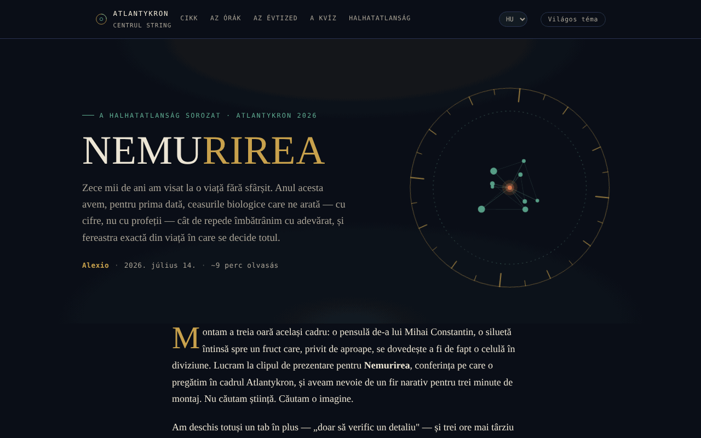

# NEMURIREA — A kor, amely megírja biológiai sorsunkat

[English](README.md) · [Română](README.ro.md) · [Français](README.fr.md) · [Italiano](README.it.md) · [Español](README.es.md) · [Português](README.pt.md) · [Deutsch](README.de.md) · **Magyar**

**Verzió:** 1.2.5 · **Utolsó frissítés:** 2026-10-23

A felület nyelvei: **Română, English, Français, Italiano, Español, Português (PT), Deutsch, Magyar**

Interaktív esszé a biológiai órákról és a hosszú élet tudományáról, a Nemurirea sorozatban, Atlantykron 2026.

**Online alkalmazás:** https://chiuta.github.io/Nemurirea/

## Mi ez

A NEMURIREA egyetlen HTML-fájlból álló esszéoldal, Alexio jegyzi, kelte 2026. 07. 14. (kb. 9 perc olvasás). Kiindulópontja az Elena Oceanu által prof. dr. Alberto Berettával készített, a SmartLiving.ro oldalon megjelent interjú, valamint a Milan Longevity Summit 2026 rendezvényen bemutatott adatok; a szöveg kijelenti, hogy a tudományos gondolatok Berettát és az idézett kutatókat illetik, az értelmezés és a szerkezet pedig az esszé szerzőjét. Az esszé tájékoztató és oktató célú, nem minősül orvosi tanácsnak (az alkalmazásban szereplő pontosítás).

## Funkciók

- Szakaszokra tagolt esszé: „A tízezer éves régi álom” (idővonal Gilgamestől a krionikáig), „Az igazi órák” (epigenetikai óra, GlycanAge, proteomikai órák), „Három felfedezés a Milan Longevity Summit 2026-ról”, „A döntő évtized”, „Hogyan különböztessük meg a tudományt a marketingtől”, „Teszteld a tudományos ösztönödet”, „Az igazi halhatatlanság”, „Források és olvasnivalók”.
- Navigáció a fejlécben: Cikk, Az órák, Az évtized, A teszt, A halhatatlanság.
- Tudományosösztön-teszt: öt kérdés, véletlenszerűen kiválasztva tízből (feleletválasztós, a válaszok sorrendje összekeverve), minden válasz után magyarázó megjegyzéssel („Következő kérdés”, „Teszt újrakezdése”); a végén hivatkozások az esszé azon szakaszaira, amelyek a hibás válaszoknak felelnek meg.
- Vékony olvasási folyamatjelző sáv az oldal tetején (nyomtatáskor rejtett).
- „↑” gomb az oldal tetejére való visszatéréshez; az elemek görgetés közben fokozatosan jelennek meg.
- „Világos téma / Éjszakai téma” gomb a fejlécben (az éjszakai téma marad az alapértelmezett; a választás a `localStorage`-ban tárolódik, ha a böngésző engedi).
- Közösségi előnézeti kép (`nemurirea-og.png`) megosztáshoz.

## Használati útmutató

1. Olvasd el az esszét az oldal görgetésével, vagy használd a fejléc hivatkozásait (Cikk, Az órák, Az évtized, A teszt, A halhatatlanság).
2. A „Teszteld a tudományos ösztönödet” szakaszban válassz választ minden kérdésre; megjelenik a magyarázó megjegyzés.
3. A folytatáshoz nyomd meg a „Következő kérdés” gombot; a végén a „Teszt újrakezdése” gombbal kezdheted elölről.
4. A „Források és olvasnivalók” szakasz az idézett forrásokra mutató hivatkozásokat tartalmazza (SmartLiving.ro, Milan Longevity Summit, SoLongevity, Nobel Prize, arXiv, GlycanAge).
5. A „↑” gomb visszavisz az oldal tetejére.

## Adatvédelem és hálózat

- Helyi: az egyetlen, `localStorage`-ban tárolt érték a téma választása (kulcs: `nemurirea.tema`); `sessionStorage`-ot és IndexedDB-t nem használ, a teszt eredményét nem menti.
- Hálózat: nem találtam `fetch` hívást, sem külső szkriptet vagy betűtípust; az oldal egyetlen fájlból töltődik be (plusz a `nemurirea-og.png` kép, amelyet csak közösségi előnézetként használ).
- A külső hivatkozások (smartliving.ro, milanlongevitysummit.org, solongevity.com, nobelprize.org, arxiv.org, glycanage.com, centrulstring.ro) csak kattintásra nyílnak meg. A lábléc kijelenti: „Egyetlen fájl, offline, telemetria nélkül”.

## Helyi futtatás / offline

Töltsd le az `index.html` fájlt, és nyisd meg böngészőben; az esszé és a teszt internet nélkül is működik. A „Források és olvasnivalók” hivatkozásaihoz internet kell.

## Előzmények / Changelog

### 1.2.4 — 2026-10-22

fff-kit 1.1.4: érintési célok és minimális szövegméret. Érintési célok/szöveg javítva az alkalmazásban.

### 1.2.3 — 2026-10-22

fff-kit 1.1.2: PBKDF2 600 000 iterációval, clickjacking elleni védelem.

### 1.2.2 — 2026-10-22
- Mobil: a szöveg legalább 12 px, a gombok és mezők érintési felülete pedig nagyobb keskeny képernyőn.
- Mobil: javítva a fejléc 2 px-es vízszintes túlcsordulása (a téma gomb 360 px-es képernyőn már nem lóg ki); a hivatkozáslisták linkjeinek érintési felülete nagyobb.

### 1.1.0 — 2026-10-14
- Adatmentés és adatcímkézés (fff-kit).

### 1.0.0 — 2026. október 12.
- A verzió és az utolsó frissítés dátuma megjelenik az alkalmazásban (lábléc).

### 11.10.2026 (harmadik frissítés) — 2026. október 11.
- Opcionális világos téma (gomb a fejlécben; a kontrasztot axe-szel ellenőriztük mindkét témában, asztali gépen és mobilon); az éjszakai téma marad az alapértelmezett.
- CSP: `connect-src 'none'`.

### 11.10.2026 (második frissítés) — 2026. október 11.
- Teszt: a készlet 5-ről 10 kérdésre bővült (mind az esszé szövegén alapul); minden kör véletlenszerűen 5-öt húz, így az újrakezdés már nem ismétli mindig ugyanazokat a kérdéseket; az eredmény jelzi az újraolvasandó szakaszokat.
- Olvasási folyamatjelző sáv.

### 11.10.2026 — 2026. október 11.
- A teszt: a válaszlehetőségek sorrendje minden kérdésnél és minden újrakezdéskor összekeveredik (a helyes válasz már nem szinte mindig a második lehetőség).
- Szigorú Content-Security-Policy hozzáadva (szkript hash-sel, hálózati kapcsolatok nélkül); axe-ellenőrzés szabálysértés nélkül.

## Licenc

MIT — lásd a `LICENSE` fájlt. Az alkalmazás lábléce ezt jelzi: „© 2026 Centrul STRING · Szöveg és szerkesztés: Alexio”.

## Szerző

Alexio — Alexandru-Ionuț Chiuță, kapcsolat: alexio@trom.tf. Az alkalmazás a Centrul STRING-et (CSPCF) említi a Nemurirea sorozat kiadójaként az Atlantykron 2026 keretében.

## Összefoglaló
A NEMURIREA egyetlen fájlból álló, román nyelvű esszé a biológiai öregedési órákról és a hosszú élet tudományáról (a Nemurirea sorozat része, Atlantykron 2026), rövid feleletválasztós kvízzel. Prof. Alberto Beretta interjúján és a Milan Longevity Summit 2026 adatain alapul. Böngészőtárolást és külső kéréseket nem találtunk; tájékoztató jellegű, nem orvosi tanács.
