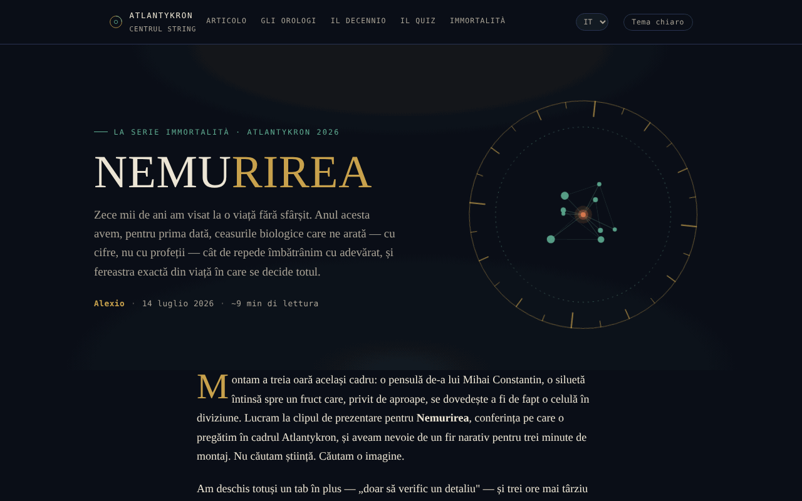

# NEMURIREA — L'età che scrive il nostro destino biologico

[English](README.md) · [Română](README.ro.md) · [Français](README.fr.md) · **Italiano** · [Español](README.es.md) · [Português](README.pt.md) · [Deutsch](README.de.md) · [Magyar](README.hu.md)

**Versione:** 1.2.4 · **Ultimo aggiornamento:** 2026-10-22

Lingue dell'interfaccia: **Română, English, Français, Italiano, Español, Português (PT), Deutsch, Magyar**

Saggio interattivo sugli orologi biologici e sulla scienza della longevità, nella serie Nemurirea, Atlantykron 2026.

**App online:** https://chiuta.github.io/Nemurirea/

## Che cos'è

NEMURIREA è una pagina-saggio in un unico file HTML, firmata da Alexio, datata 14/07/2026 (circa 9 minuti di lettura). Parte dall'intervista realizzata da Elena Oceanu al prof. dott. Alberto Beretta, pubblicata su SmartLiving.ro, e dai dati presentati al Milan Longevity Summit 2026; il testo dichiara che le idee scientifiche appartengono a Beretta e ai ricercatori citati, mentre l'interpretazione e la struttura appartengono all'autore del saggio. Il saggio ha scopo informativo ed educativo e non costituisce un consiglio medico (precisazione presente nell'app).

## Funzionalità

- Saggio per sezioni: «Il vecchio sogno di diecimila anni» (cronologia da Gilgameš alla crionica), «Gli orologi veri» (orologio epigenetico, GlycanAge, orologi proteomici), «Tre scoperte dal Milan Longevity Summit 2026», «Il decennio decisivo», «Come distinguere la scienza dal marketing», «Metti alla prova il tuo istinto scientifico», «La vera immortalità», «Fonti e letture».
- Navigazione nell'intestazione: Articolo, Gli orologi, Il decennio, Il test, L'immortalità.
- Test dell'istinto scientifico: cinque domande scelte a caso da un insieme di dieci (risposta multipla, ordine delle risposte mescolato), con una nota esplicativa dopo ogni risposta («Domanda successiva», «Rifai il test»); alla fine, rimandi alle sezioni del saggio corrispondenti alle risposte sbagliate.
- Sottile barra di avanzamento della lettura in alto (nascosta in stampa).
- Pulsante «↑» per tornare all'inizio della pagina; gli elementi compaiono progressivamente durante lo scorrimento.
- Pulsante «Tema chiaro / Tema notte» nell'intestazione (il tema notte resta quello predefinito; la scelta viene conservata in `localStorage`, se il browser lo consente).
- Immagine di anteprima social (`nemurirea-og.png`) per la condivisione.

## Guida all'uso

1. Leggi il saggio scorrendo la pagina oppure usa i link nell'intestazione (Articolo, Gli orologi, Il decennio, Il test, L'immortalità).
2. Nella sezione «Metti alla prova il tuo istinto scientifico» scegli una risposta per ogni domanda; compare la nota esplicativa.
3. Premi «Domanda successiva» per continuare; alla fine premi «Rifai il test» per ricominciare.
4. La sezione «Fonti e letture» contiene i link alle fonti citate (SmartLiving.ro, Milan Longevity Summit, SoLongevity, Nobel Prize, arXiv, GlycanAge).
5. Il pulsante «↑» ti riporta in alto.

## Privacy e rete

- Locale: l'unico valore conservato in `localStorage` è la scelta del tema (chiave `nemurirea.tema`); non si usano `sessionStorage` né IndexedDB e il risultato del test non viene salvato.
- Rete: non ho trovato chiamate `fetch` né script o font esterni; la pagina si carica da un unico file (più l'immagine `nemurirea-og.png`, usata solo come anteprima social).
- I link esterni (smartliving.ro, milanlongevitysummit.org, solongevity.com, nobelprize.org, arxiv.org, glycanage.com, centrulstring.ro) si aprono solo se li clicchi. Il piè di pagina dichiara «File unico, offline, senza telemetria».

## Esecuzione locale / offline

Scarica `index.html` e aprilo in un browser; il saggio e il test funzionano senza internet. I link in «Fonti e letture» richiedono internet.

## Cronologia / Changelog

### 1.2.4 — 2026-10-22

fff-kit 1.1.4: aree tattili e testo minimo. Aree tattili/testo corretti nell’app.

### 1.2.3 — 2026-10-22

fff-kit 1.1.2: PBKDF2 a 600.000 iterazioni, protezione anti-clickjacking.

### 1.2.2 — 2026-10-22
- Mobile: il testo è di almeno 12 px e pulsanti e campi hanno aree tattili più grandi sugli schermi stretti.
- Mobile: corretto lo sforamento orizzontale di 2 px dell'intestazione (il pulsante del tema non sporge più su schermi da 360 px); i link degli elenchi di riferimenti hanno aree tattili più grandi.

### 1.1.0 — 2026-10-14
- Backup ed etichettatura dei dati (fff-kit).

### 1.0.0 — 12 ottobre 2026
- La versione e la data dell'ultimo aggiornamento sono mostrate nell'app (piè di pagina).

### 11.10.2026 (terzo aggiornamento) — 11 ottobre 2026
- Tema chiaro facoltativo (pulsante nell'intestazione; contrasto verificato con axe in entrambi i temi, su desktop e mobile); il tema notte resta quello predefinito.
- CSP: `connect-src 'none'`.

### 11.10.2026 (secondo aggiornamento) — 11 ottobre 2026
- Test: l'insieme è stato esteso da 5 a 10 domande (tutte basate sul testo del saggio); ogni giro ne estrae 5 a caso, così rifare il test non ripete sempre le stesse domande; il risultato indica le sezioni da rileggere.
- Barra di avanzamento della lettura.

### 11.10.2026 — 11 ottobre 2026
- Il test: l'ordine delle opzioni di risposta viene mescolato a ogni domanda e a ogni ripetizione (la risposta corretta non è più quasi sempre la seconda opzione).
- Aggiunta una Content-Security-Policy rigorosa (script con hash, nessuna connessione di rete); verifica axe senza violazioni.

## Licenza

MIT — vedi il file `LICENSE`. Il piè di pagina dell'app indica: «© 2026 Centrul STRING · Testo e montaggio: Alexio».

## Autore

Alexio — Alexandru-Ionuț Chiuță, contatto: alexio@trom.tf. L'app cita il Centrul STRING (CSPCF) come editore della serie Nemurirea nell'ambito di Atlantykron 2026.

## Riepilogo
NEMURIREA è un saggio in lingua rumena, a file singolo, sugli orologi biologici dell'invecchiamento e sulla scienza della longevità (serie Nemurirea, Atlantykron 2026), con un breve quiz a risposta multipla. Si basa su un'intervista al prof. Alberto Beretta e sui dati del Milan Longevity Summit 2026. Non sono stati trovati né archiviazione nel browser né richieste esterne; contenuto informativo, non un consiglio medico.
