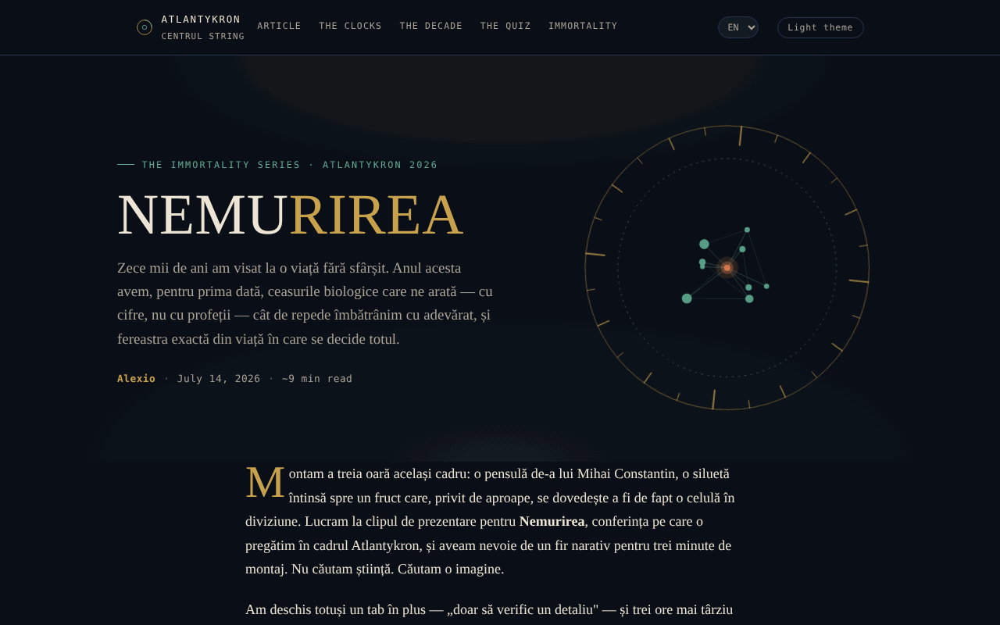

# NEMURIREA — The Age That Writes Our Biological Destiny

**English** · [Română](README.ro.md) · [Français](README.fr.md) · [Italiano](README.it.md) · [Español](README.es.md) · [Português](README.pt.md) · [Deutsch](README.de.md) · [Magyar](README.hu.md)

**Version:** 1.2.1 · **Last updated:** 2026-10-19

Interface languages: **Română, English, Français, Italiano, Español, Português (PT), Deutsch, Magyar**

An interactive essay on biological clocks and the science of longevity, part of the Nemurirea series, Atlantykron 2026.

**Live app:** https://chiuta.github.io/Nemurirea/

## What it is

NEMURIREA is an essay page in a single HTML file, signed by Alexio, dated 14/07/2026 (about 9 minutes' reading). It starts from the interview that Elena Oceanu conducted with Prof. Dr. Alberto Beretta, published on SmartLiving.ro, and from the data presented at the Milan Longevity Summit 2026; the text states that the scientific ideas belong to Beretta and the researchers cited, while the interpretation and structure belong to the essay's author. The essay is informational and educational and does not constitute medical advice (a statement made in the app).

## Features

- Essay in sections: "The ten-thousand-year-old dream" (a timeline from Gilgamesh to cryonics), "The real clocks" (the epigenetic clock, GlycanAge, proteomic clocks), "Three discoveries from the Milan Longevity Summit 2026", "The decisive decade", "How to tell science from marketing", "Test your scientific instinct", "True immortality", "Sources and further reading".
- Header navigation: Article, The clocks, The decade, The test, Immortality.
- Scientific-instinct test: five questions drawn at random from a set of ten (multiple choice, answer order shuffled), with an explanatory note after each answer ("Next question", "Retake the test"); at the end, pointers to the essay sections corresponding to the wrong answers.
- Thin reading-progress bar at the top (hidden when printing).
- "↑" button to return to the top of the page; elements appear progressively on scrolling.
- "Light theme / Night theme" button in the header (the night theme remains the default; the choice is kept in `localStorage`, if the browser allows it).
- Social preview image (`nemurirea-og.png`) for sharing.

## User guide

1. Read the essay by scrolling the page, or use the links in the header (Article, The clocks, The decade, The test, Immortality).
2. In the "Test your scientific instinct" section, choose an answer for each question; the explanatory note appears.
3. Press "Next question" to continue; at the end press "Retake the test" to start over.
4. The "Sources and further reading" section contains the links to the cited sources (SmartLiving.ro, Milan Longevity Summit, SoLongevity, Nobel Prize, arXiv, GlycanAge).
5. The "↑" button takes you back to the top.

## Privacy and network

- Local: the only value kept in `localStorage` is the theme choice (key `nemurirea.tema`); `sessionStorage` and IndexedDB are not used, and the test result is not saved.
- Network: I found no `fetch` calls and no external scripts or fonts; the page loads from a single file (plus the image `nemurirea-og.png`, used only as a social preview).
- The external links (smartliving.ro, milanlongevitysummit.org, solongevity.com, nobelprize.org, arxiv.org, glycanage.com, centrulstring.ro) open only if you click them. The footer states "Single file, offline, no telemetry".

## Running locally / offline

Download `index.html` and open it in a browser; the essay and the test work without internet. The links in "Sources and further reading" require internet.

## History / Changelog

### 1.1.0 — 2026-10-14
- Backup and data labelling (fff-kit).

### 1.0.0 — 12 October 2026
- The version and the last-updated date are shown in the app (footer).

### 11.10.2026 (third update) — 11 October 2026
- Optional light theme (button in the header; contrast checked with axe in both themes, on desktop and mobile); the night theme remains the default.
- CSP: `connect-src 'none'`.

### 11.10.2026 (second update) — 11 October 2026
- Test: the set was extended from 5 to 10 questions (all based on the essay's text); each round draws 5 at random, so retaking no longer repeats the same questions; the result points to the sections to reread.
- Reading-progress bar.

### 11.10.2026 — 11 October 2026
- The test: the order of the answer options is shuffled for every question and every retake (the correct answer is no longer almost always the second option).
- Added a strict Content-Security-Policy (script with hash, no network connections); axe check with no violations.

## License

MIT — see the `LICENSE` file. The app footer states: "© 2026 Centrul STRING · Text and layout: Alexio".

## Author

Alexio — Alexandru-Ionuț Chiuță, contact: alexio@trom.tf. The app mentions Centrul STRING (CSPCF) as publisher of the Nemurirea series within Atlantykron 2026.

## English summary

NEMURIREA is a single-file Romanian-language essay on biological aging clocks and longevity science (part of the Nemurirea series, Atlantykron 2026), with a short multiple-choice quiz. Based on an interview with Prof. Alberto Beretta and Milan Longevity Summit 2026 data. No browser storage and no external requests were found; it is informational, not medical advice.
