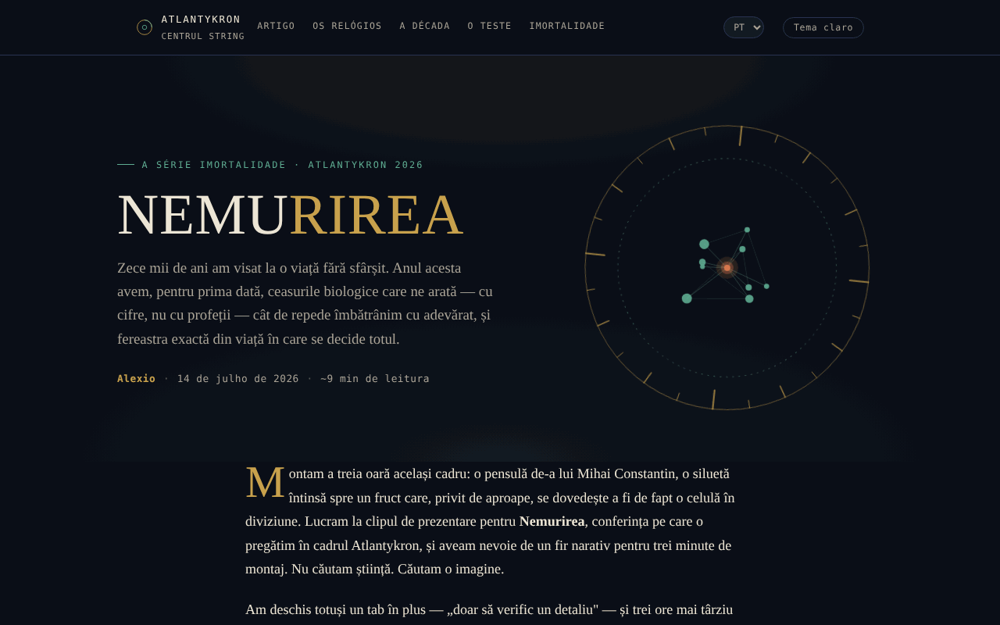

# NEMURIREA — A idade que escreve o nosso destino biológico

[English](README.md) · [Română](README.ro.md) · [Français](README.fr.md) · [Italiano](README.it.md) · [Español](README.es.md) · **Português** · [Deutsch](README.de.md) · [Magyar](README.hu.md)

**Versão:** 2.0.0 · **Última atualização:** 2026-10-26

Idiomas da interface: **Română, English, Français, Italiano, Español, Português (PT), Deutsch, Magyar**

Ensaio interativo sobre os relógios biológicos e a ciência da longevidade, na série Nemurirea, Atlantykron 2026.

**Aplicação online:** https://chiuta.github.io/Nemurirea/

## O que é

NEMURIREA é uma página-ensaio num único ficheiro HTML, assinada por Alexio, datada de 14/07/2026 (cerca de 9 minutos de leitura). Parte da entrevista realizada por Elena Oceanu ao prof. dr. Alberto Beretta, publicada no SmartLiving.ro, e dos dados apresentados na Milan Longevity Summit 2026; o texto declara que as ideias científicas pertencem a Beretta e aos investigadores citados, ao passo que a interpretação e a estrutura pertencem ao autor do ensaio. O ensaio tem fins informativos e educativos e não constitui aconselhamento médico (precisão constante da aplicação).

## Funcionalidades

- Ensaio em secções: «O velho sonho de dez mil anos» (cronologia de Gilgámesh à criogenia), «Os relógios verdadeiros» (relógio epigenético, GlycanAge, relógios proteómicos), «Três descobertas da Milan Longevity Summit 2026», «A década decisiva», «Como distinguir a ciência do marketing», «Teste o seu instinto científico», «A verdadeira imortalidade», «Fontes e leituras».
- Navegação no cabeçalho: Artigo, Os relógios, A década, O teste, A imortalidade.
- Teste de instinto científico: cinco perguntas escolhidas ao acaso de um conjunto de dez (escolha múltipla, ordem das respostas misturada), com uma nota explicativa após cada resposta («Pergunta seguinte», «Refazer o teste»); no fim, remissões para as secções do ensaio correspondentes às respostas erradas.
- Barra fina de progresso da leitura no topo (oculta na impressão).
- Botão «↑» para voltar ao início da página; os elementos surgem progressivamente ao deslocar.
- Botão «Tema claro / Tema noturno» no cabeçalho (o tema noturno continua a ser o predefinido; a escolha é guardada em `localStorage`, se o navegador o permitir).
- Imagem de pré-visualização social (`nemurirea-og.png`) para partilha.

## Manual de utilização

1. Leia o ensaio deslocando a página ou use as ligações do cabeçalho (Artigo, Os relógios, A década, O teste, A imortalidade).
2. Na secção «Teste o seu instinto científico», escolha uma resposta para cada pergunta; aparece a nota explicativa.
3. Prima «Pergunta seguinte» para continuar; no fim, prima «Refazer o teste» para recomeçar.
4. A secção «Fontes e leituras» contém as ligações para as fontes citadas (SmartLiving.ro, Milan Longevity Summit, SoLongevity, Nobel Prize, arXiv, GlycanAge).
5. O botão «↑» leva-o de volta ao topo.

## Privacidade e rede

- Local: o único valor guardado em `localStorage` é a escolha do tema (chave `nemurirea.tema`); não são usados `sessionStorage` nem IndexedDB, e o resultado do teste não é guardado.
- Rede: não encontrei chamadas `fetch` nem scripts ou tipos de letra externos; a página carrega a partir de um único ficheiro (mais a imagem `nemurirea-og.png`, usada apenas como pré-visualização social).
- As ligações externas (smartliving.ro, milanlongevitysummit.org, solongevity.com, nobelprize.org, arxiv.org, glycanage.com, centrulstring.ro) só se abrem se clicar nelas. O rodapé declara «Ficheiro único, offline, sem telemetria».

## Execução local / offline

Transfira `index.html` e abra-o num navegador; o ensaio e o teste funcionam sem internet. As ligações de «Fontes e leituras» exigem internet.

## Histórico / Changelog

### 1.2.4 — 2026-10-22

fff-kit 1.1.4: áreas de toque e texto mínimo. Áreas de toque/texto corrigidos na aplicação.

### 1.2.3 — 2026-10-22

fff-kit 1.1.2: PBKDF2 com 600.000 iterações, proteção anti-clickjacking.

### 1.2.2 — 2026-10-22
- Móvel: o texto tem pelo menos 12 px e os botões e campos têm áreas táteis maiores em ecrãs estreitos.
- Móvel: corrigido o excesso horizontal de 2 px do cabeçalho (o botão de tema já não sobressai em ecrãs de 360 px); as ligações das listas de referências têm áreas táteis maiores.

### 1.1.0 — 2026-10-14
- Cópia de segurança e etiquetagem de dados (fff-kit).

### 1.0.0 — 12 de outubro de 2026
- A versão e a data da última atualização são apresentadas na aplicação (rodapé).

### 11.10.2026 (terceira atualização) — 11 de outubro de 2026
- Tema claro opcional (botão no cabeçalho; contraste verificado com axe nos dois temas, em computador e telemóvel); o tema noturno continua a ser o predefinido.
- CSP: `connect-src 'none'`.

### 11.10.2026 (segunda atualização) — 11 de outubro de 2026
- Teste: o conjunto foi alargado de 5 para 10 perguntas (todas baseadas no texto do ensaio); cada ronda sorteia 5, pelo que refazer o teste já não repete sempre as mesmas perguntas; o resultado indica as secções a reler.
- Barra de progresso da leitura.

### 11.10.2026 — 11 de outubro de 2026
- O teste: a ordem das opções de resposta é misturada em cada pergunta e em cada repetição (a resposta correta já não é quase sempre a segunda opção).
- Adicionada uma Content-Security-Policy rigorosa (script com hash, sem ligações de rede); verificação axe sem violações.

## Licença

MIT — veja o ficheiro `LICENSE`. O rodapé da aplicação indica: «© 2026 Centrul STRING · Texto e montagem: Alexio».

## Autor

Alexio — Alexandru-Ionuț Chiuță, contacto: alexio@trom.tf. A aplicação menciona o Centrul STRING (CSPCF) como editor da série Nemurirea no âmbito da Atlantykron 2026.

## Resumo
NEMURIREA é um ensaio em romeno, num único ficheiro, sobre os relógios biológicos do envelhecimento e a ciência da longevidade (série Nemurirea, Atlantykron 2026), com um breve questionário de escolha múltipla. Baseia-se numa entrevista com o prof. Alberto Beretta e em dados da Milan Longevity Summit 2026. Não foram encontrados armazenamento no navegador nem pedidos externos; é informativo, não aconselhamento médico.
