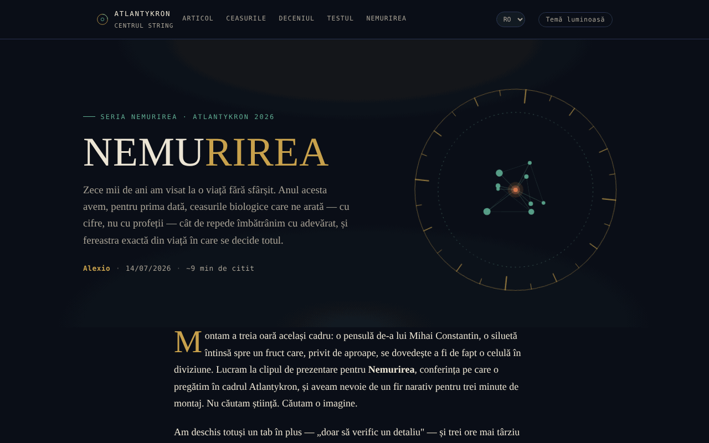

# NEMURIREA — Vârsta care ne scrie destinul biologic

[English](README.md) · **Română** · [Français](README.fr.md) · [Italiano](README.it.md) · [Español](README.es.md) · [Português](README.pt.md) · [Deutsch](README.de.md) · [Magyar](README.hu.md)

**Versiune:** 1.2.2 · **Ultima actualizare:** 2026-10-22

Limbile interfeței: **Română, English, Français, Italiano, Español, Português (PT), Deutsch, Magyar**

Eseu interactiv despre ceasurile biologice și știința longevității, în seria Nemurirea, Atlantykron 2026.

**Live:** https://chiuta.github.io/Nemurirea/

## Ce este

NEMURIREA este o pagină-eseu dintr-un singur fișier HTML, semnată Alexio, datată 14/07/2026 (aproximativ 9 minute de citit). Pornește de la interviul realizat de Elena Oceanu cu prof. dr. Alberto Beretta, publicat în SmartLiving.ro, și de la datele prezentate la Milan Longevity Summit 2026; textul declară că ideile științifice aparțin lui Beretta și cercetătorilor citați, iar interpretarea și structura aparțin autorului eseului. Eseul are scop informativ și educațional și nu constituie sfat medical (precizare din aplicație).

## Funcții

- Eseu în secțiuni: „Visul vechi de zece mii de ani" (cronologie de la Ghilgameș la criogenie), „Ceasurile adevărate" (ceasul epigenetic, GlycanAge, ceasurile proteomice), „Trei descoperiri de la Milan Longevity Summit 2026", „Deceniul decisiv", „Cum deosebești știința de marketing", „Testează-ți instinctul științific", „Nemurirea adevărată", „Surse și lecturi".
- Navigare în antet: Articol, Ceasurile, Deceniul, Testul, Nemurirea.
- Test de instinct științific: cinci întrebări alese la întâmplare dintr-un set de zece (variante multiple, ordinea variantelor amestecată), cu notă explicativă după fiecare răspuns („Următoarea întrebare”, „Ia testul de la capăt”); la final, trimiteri către secțiunile eseului corespunzătoare răspunsurilor greșite.
- Bară subțire de progres al lecturii în partea de sus (ascunsă la tipărire).
- Buton „↑" de întoarcere la începutul paginii; elementele apar progresiv la derulare.
- Buton „Temă luminoasă / Temă de noapte” în antet (implicit rămâne tema de noapte; alegerea se păstrează în `localStorage`, dacă browserul permite).
- Imagine de previzualizare socială (`nemurirea-og.png`) pentru partajare.

## Manual de utilizare

1. Citește eseul derulând pagina sau folosește linkurile din antet (Articol, Ceasurile, Deceniul, Testul, Nemurirea).
2. În secțiunea „Testează-ți instinctul științific" alege un răspuns pentru fiecare întrebare; apare nota explicativă.
3. Apasă „Următoarea întrebare" pentru a continua; la final apasă „Ia testul de la capăt" pentru a relua.
4. Secțiunea „Surse și lecturi" conține linkurile către sursele citate (SmartLiving.ro, Milan Longevity Summit, SoLongevity, Nobel Prize, arXiv, GlycanAge).
5. Butonul „↑" te readuce sus.

## Confidențialitate și rețea

- Local: singura valoare păstrată în `localStorage` este alegerea temei (cheia `nemurirea.tema`); nu se folosesc `sessionStorage` sau IndexedDB, iar rezultatul testului nu se salvează.
- Rețea: nu am găsit apeluri `fetch`, scripturi sau fonturi externe; pagina se încarcă dintr-un singur fișier (plus imaginea `nemurirea-og.png`, folosită doar ca previzualizare socială).
- Linkurile externe (smartliving.ro, milanlongevitysummit.org, solongevity.com, nobelprize.org, arxiv.org, glycanage.com, centrulstring.ro) se deschid doar dacă le apeși. Subsolul declară „Fișier unic, offline, fără telemetrie".

## Rulare locală / offline

Descarcă `index.html` și deschide-l în browser; eseul și testul funcționează fără internet. Linkurile din „Surse și lecturi" necesită internet.

## Istoric / Changelog

### 1.2.2 — 2026-10-22
- Mobil: textul are cel puțin 12 px, iar butoanele și câmpurile au ținte tactile mai mari pe ecrane înguste.
- Mobil: corectat depășirea orizontală de 2 px a antetului (butonul de temă nu mai iese din ecran la 360 px); linkurile din listele de referințe au ținte tactile mai mari.

### 1.1.0 — 2026-10-14
- Copie de rezervă și etichetare date (fff-kit).

### 1.0.0 — 12 octombrie 2026
- Versiunea și data ultimei actualizări sunt afișate în aplicație (subsol).

### 11.10.2026 (a treia actualizare) — 11 octombrie 2026
- Temă luminoasă opțională (buton în antet; contrast verificat cu axe în ambele teme, pe desktop și mobil); tema de noapte rămâne implicită.
- CSP: `connect-src 'none'`.

### 11.10.2026 (a doua actualizare) — 11 octombrie 2026
- Test: set extins de la 5 la 10 întrebări (toate pe baza textului eseului); fiecare rundă ia 5 la întâmplare, deci reluarea nu mai repetă mereu aceleași întrebări; rezultatul indică secțiunile de recitit.
- Bară de progres al lecturii.

### 11.10.2026 — 11 octombrie 2026
- Testul: ordinea variantelor de răspuns se amestecă la fiecare întrebare și la fiecare reluare (răspunsul corect nu mai e aproape mereu a doua opțiune).
- Adăugat Content-Security-Policy strict (script cu hash, fără conexiuni de rețea); verificare axe fără încălcări.

## Licență

MIT — vezi fișierul `LICENSE`. Subsolul aplicației indică: „© 2026 Centrul STRING · Text și montaj: Alexio".

## Autor

Alexio — Alexandru-Ionuț Chiuță, contact: alexio@trom.tf. Aplicația menționează Centrul STRING (CSPCF) ca editor al seriei Nemurirea în cadrul Atlantykron 2026.

## Rezumat

NEMURIREA este un eseu într-un singur fișier, în limba română, despre ceasurile biologice ale îmbătrânirii și știința longevității (parte a seriei Nemurirea, Atlantykron 2026), cu un scurt test cu variante multiple. Se bazează pe un interviu cu prof. Alberto Beretta și pe date de la Milan Longevity Summit 2026. Nu s-a găsit stocare în browser și nici cereri externe; are caracter informativ, nu constituie sfat medical.
